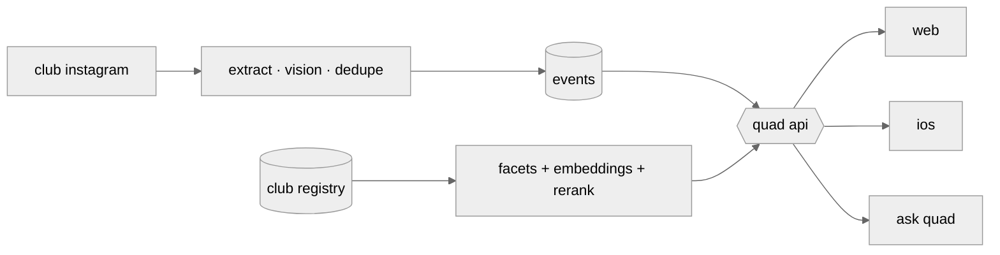

<p align="center">
  <a href="https://joinquad.ai"></a>
</p>

<p align="center">
  <a href="https://joinquad.ai"></a>
  <a href="https://x.com/kian_lakhani"></a>
  <a href="https://www.linkedin.com/in/kian-l-0125b5280/"></a>
</p>

<br>

## ┌ now ┐

**[quad](https://joinquad.ai)** · co-founder + cto

the network for the rooms already on campus. every club, every event, every open role at your school, in one place, with an assistant that already knows you. bootstrapped to 2,500+ students across 12 universities, featured in the columbia daily spectator, and partnered with wall street oasis to bring its bootcamps and recruiting tools to quad students.

<p align="center"></p>



**the hard parts**

- **ingestion.** a distributed engine indexing thousands of clubs and events across 12 universities, with adapters for js-rendered, paginated campus platforms like campusgroups, all normalized into one schema.
- **flyers to events.** club instagram posts run through extract, vision, dedupe and enrich. a poster becomes a real event with a time, a room and a host, no club typing anything.
- **ask quad.** a campus copilot. "what's on this week", "what should i join", "remind me an hour before". tools over a sql semantic layer, dates computed in code, one-tap consent on every write, multi-turn memory, and an eval suite of 100+ real student conversations gating every deploy.
- **recommendations.** exploration against personalization. facet labels and embedding retrieval, unioned and reranked once per student, prewarmed nightly. scored against what students actually followed a week later, not a judge's opinion.
- **the registry.** thousands of clubs across launch campuses. labelled, deduped, cleaned. the data is the product.
- **two clients, one kitchen.** swiftui and next.js on one postgres backend, rendering the same payloads down to the recommendation cards. shipped weekly.

<br>

**[the ninety labs](https://github.com/KLKH7/the-ninety-labs)** · microsoft × premier league hackathon

ai that watches the match, logs every event, and describes it to every fan, including the ones who can't see it. football event data is still typed by hand, a few analysts per match, which is why it stops at the top flight.

- **a football engine that writes its own answer key.** players decide, physics happens, a referee observes. every rule cites a law of the game or a published study, and every clip passes a ground-truth contract before anything trains on it.
- **broadcast video from the same engine.** exact camera, boxes, visibility and keypoints per frame, with hard-case knobs (lighting, kit contrast, crowding, blur) so vision is tested where it fails.
- **building now: agents that can't make up a number.** code computes every stat, agents only explain, and a fact-checking agent gates what reaches the screen. audio description for blind and low-vision fans is the point, not a feature.

<br>

## ┌ before ┐

**circle** · ai engineer · san francisco · [decla.com ↗](https://decla.com)

insurance ai, backed by unusual ventures. decla reads an agency's inbox, searches its management system, pulls carrier documents and drafts the next step, then drives the carrier portal in a live browser once a human approves.

- **owned agent evaluation** for the browser-automation product. designed and built the cli eval harness from an open-ended mandate. every run scored on task success, token cost and latency.
- **built a 30+ task regression suite** from real production failures and benchmarked frontier models against it through openrouter. the results picked the production model.
- **rag over policy and claims data**, end to end. chunking, embeddings, retrieval ranking and grounded synthesis, turning inconsistent output into repeatable answers.
- **shipped platform features to prod**: totp mfa, social login, a support portal with escalation routing, and the integrations hub. ran customer onboarding calls and turned them into product changes inside the week.

<br>

## ┌ also ┐

<table>
<tr><td width="34%"><b>devfest</b><br><sub>adi · engineering lead</sub></td><td>building the platform for columbia's flagship hackathon, 1,000+ hackers, sponsors and judges, from application to demo day.</td></tr>
<tr><td width="34%"><a href="https://www.openplans.org"><b>openplans</b></a><br><sub>columbia software solutions · pm</sub></td><td>forward-deployed lead on a campaign tracking and reporting platform for a nyc nonprofit fighting for people-first streets.</td></tr>
<tr><td width="34%"><b>aqa</b><br><sub>student advisory consultant</sub></td><td>one of 8 students advising the uk's largest exam board. presented ai curriculum policy in parliament and taught my school's first elective on ai theory and ethics.</td></tr>
</table>

<br>

## ┌ side projects ┐

<table>
<tr><td width="34%"><a href="https://github.com/KLKH7/harborview-dock-scheduler"><b>harborview dock scheduler</b></a><br><sub><a href="https://harborview-dock-scheduler.vercel.app">live ↗</a></sub></td><td>berth reservations rebuilt from 23 years of spreadsheets. double-bookings and vessel fit, once done by eye, now computed.</td></tr>
<tr><td width="34%"><a href="https://github.com/KLKH7/EchoAppYHack"><b>echo</b></a><br><sub>🏆 yhack 2026, social impact winner</sub></td><td>wearable navigation. a raspberry pi on the chest, a phone that speaks obstacles and finds the exit.</td></tr>
<tr><td width="34%"><a href="https://gl-tch.vercel.app"><b>gl-tch</b></a><br><sub>san francisco</sub></td><td>a fashion-tech show moving across the city. site, live audience pwa, post-show archive.</td></tr>
<tr><td width="34%"><b>nexus</b><br><sub>private</sub></td><td>an early graph of a student's opportunity space. people, events, ideas, and the next best move.</td></tr>
</table>

<br>

## ┌ stack ┐

```
web     typescript  next.js  react  prisma  postgres  pgvector
        clerk  vercel  tanstack query  tailwind
ios     swift  swiftui  ios 26 liquid glass
ai      rag  tool calling  embeddings  agent eval harnesses
        openai  openrouter  vector search
hw      python  raspberry pi  computer vision
```

<br>

<picture>
  <source media="(prefers-color-scheme: dark)" srcset="https://raw.githubusercontent.com/KLKH7/KLKH7/output/snake-dark.svg">
  
</picture>

<br>

<p align="center"><sub>run to every opportunity.</sub></p>
